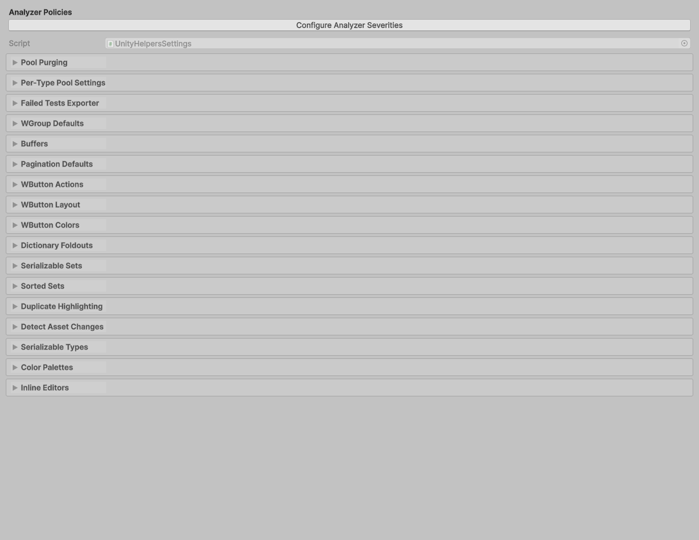
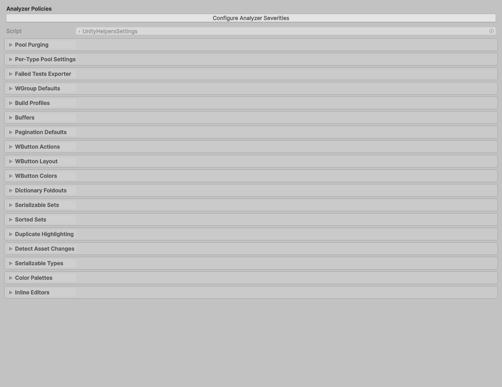

# Build profile scene synchronization

Unity 6 build profiles can inherit the global scene list or keep a custom list.
Use **Tools > Wallstop Studios > Unity Helpers > Sync Build Profile Scenes** to copy
the global list into inherited profiles. Profiles that override global scenes keep
their custom lists.

Open **Project Settings > Wallstop Studios > Unity Helpers > Build Profiles** to
choose the folders to search. The default is `Assets`; an empty list selects no
profiles. Every configured folder must already exist below `Assets`.

Enable **Auto Synchronize Build Profile Scenes** to synchronize after Unity's
scene-list change event, settings changes, domain reload, and returning to EditMode.
It is off by default. Work is queued once and runs when the Editor is idle; there
is no continuous scene-list polling. New profiles can be synchronized with the
menu command before the next scene-list change.

The copy preserves scene order, paths, scene GUIDs, and enabled flags, including disabled
entries. Matching profiles are left alone. Only changed profiles are saved;
unrelated dirty assets are not saved by this tool.

## Editor scripts

`BuildProfileSceneSync` lives in `WallstopStudios.UnityHelpers.Editor.Tools` and
is available on Unity 6 only. Its API also works in an idle batch-mode Editor.

```csharp
#if UNITY_EDITOR && UNITY_6000_0_OR_NEWER
using UnityEngine;
using WallstopStudios.UnityHelpers.Editor.Tools;

string[] folders = { "Assets/Settings/Build Profiles" };
if (!BuildProfileSceneSync.TrySynchronize(folders, out int updated, out string error))
{
    Debug.LogWarning(error);
}
#endif
```

Null folders search `Assets`. An empty collection changes nothing. Invalid folders,
PlayMode, imports, compilation, builds, and reentrant calls return `false` with an
error. A failed batch can have updated earlier profiles; inspect the error and
retry after correcting it.

Assigning `EditorBuildSettings.globalScenes` from a script does not raise Unity's
`sceneListChanged` event in the qualified Unity 6000.6.7 Editor. Call
`TrySynchronize` explicitly after that assignment. Normal scene-list edits that
raise the event use the automatic path.

Each batch records a grouped Undo operation before changing profiles. Undo restores
the in-memory list; save the profiles again to persist that reversal. File writes
are outside the full Undo guarantee. Automatic synchronization can copy the current
global list again after a later scene-list event; disable it when preserving a
manual reversal.

## Settings comparison

These native Unity 6000.6.7 light-skin captures show the settings panel before and
after adding the Build Profiles group. Both captures passed with no render errors.
The [qualification record](./build-profile-settings-20261114.json) retains the
capture fixture, controller, source hashes, and process receipts.

| Before                                                                                         | After                                                                                       |
| ---------------------------------------------------------------------------------------------- | ------------------------------------------------------------------------------------------- |
|  |  |
