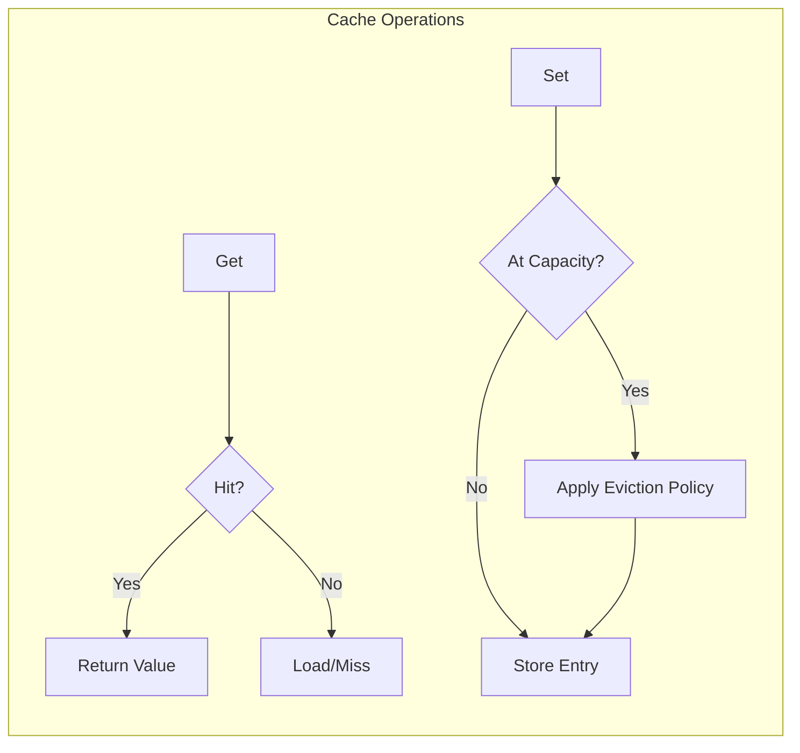

# Core Data Structures: Concepts, Usage, and Trade-offs

## TL;DR: What Problem This Solves

- Pick the right container for performance and clarity: ring buffers, deques, heaps, tries, sparse sets, etc.
- Each section gives a plain‑language “Use for / Pros / Cons” and a tiny code snapshot to copy.
- When in doubt, prefer simple .NET types; use these when you hit performance or ergonomics limits.

This guide covers several foundational data structures used across the library and when to use them.

## Cyclic Buffer (Ring Buffer)

- What it is: Fixed-capacity circular array with head/tail indices that wrap.
- Use for: Streaming data, fixed-size queues, audio/network buffers.
- Operations: enqueue/dequeue in O(1); overwriting old data optional.
- Pros: Constant-time, cache-friendly, no reallocations at steady size.
- Cons: Fixed capacity unless resized; must handle wrap-around.


When to use vs. DotNET queues

- `Contains` searches live entries only. Removed slots do not count as stored `default` or `null` values.
- Prefer `CyclicBuffer<T>` over `Queue<T>` when you want bounded memory with O(1) push/pop at both ends and predictable behavior under backpressure (drop/overwrite oldest, or pop proactively).
- Use `Queue<T>` when you need unbounded growth without wrap semantics.

API snapshot

<!-- doc-sample: compiles -->

```csharp
using WallstopStudios.UnityHelpers.Core.DataStructure;

var rb = new CyclicBuffer<int>(capacity: 4);
rb.Add(10); rb.Add(20); rb.Add(30);

// Pop from front/back
if (rb.TryPopFront(out var first)) { /* first == 10 */ }
if (rb.TryPopBack(out var last))  { /* last == 30  */ }

// Remove by value / predicate
rb.Add(40); rb.Add(50);
rb.Remove(20);                  // O(n) compacting via temp buffer
rb.RemoveAll(x => x % 2 == 0);  // remove evens

// Resize in place (may drop tail elements)
rb.Resize(8);
```

Tips and pitfalls

- Know your overflow policy. `Add` will wrap and overwrite the oldest only once capacity is reached; use `TryPopFront` periodically to keep buffer from evicting data you still need.
- Iteration enumerates logical order starting at the head, not the underlying storage order.
- `Remove`/`RemoveAll` are O(n); keep hot paths to `Add`/`TryPop*` when possible.

## Deque (Double-Ended Queue)

- What it is: Queue with efficient push/pop at both ends.
- Use for: Sliding windows, BFS frontiers, task schedulers.
- Operations: push_front/push_back/pop_front/pop_back in amortized O(1).
- Pros: Flexible ends; generalizes queue and stack behavior.
- Cons: Implementation complexity for block-based layouts.


When to use vs `Queue<T>` / `Stack<T>`

- Prefer `Deque<T>` when you need both `push_front` and `push_back` in O(1) amortized.
- Use `Queue<T>` for simple FIFO; `Stack<T>` for LIFO only.


API snapshot

<!-- doc-sample: compiles -->

```csharp
using WallstopStudios.UnityHelpers.Core.DataStructure;

var dq = new Deque<string>(capacity: 8);
dq.PushFront("start");
dq.PushBack("end");

if (dq.TryPopFront(out var a)) { /* a == "start" */ }
if (dq.TryPopBack(out var b))  { /* b == "end"   */ }

// Peeking without removal
dq.PushBack("x");
if (dq.TryPeekFront(out var f)) { /* f == "x" */ }
```

Tips

- Capacity grows geometrically as needed; call `TrimExcess()` after spikes to return memory.
- Indexer is in logical order (0 is front, Count-1 is back).
- `CopyTo(array, arrayIndex)` writes in logical order and leaves elements outside the destination
  range unchanged. Copies of at least 64 elements use one or two bulk copies when the destination
  has exactly the deque's element type. Smaller copies and covariant destination arrays retain
  element-by-element writes.
- `ToArray(ref array)` reuses a sufficiently large destination and leaves its unused tail unchanged.
  `ToArray()` allocates its result array.

## Binary Heap (Priority Queue)

- What it is: Array-backed binary tree maintaining heap-order (min/max).
- Use for: Priority queues, Dijkstra/A\*, event simulation.
- Operations: push/pop in O(log n); peek O(1); build-heap O(n).
- Pros: Simple; great constant factors; contiguous memory.
- Cons: Not ideal for decrease-key unless augmented.


When to use vs `SortedSet<T>`

- Prefer `Heap<T>`/`PriorityQueue<T>` for frequent push/pop top in O(log n) with low overhead.
- Use `SortedSet<T>` for ordered iteration and fast remove arbitrary item (by key), at higher constants.

API snapshot (Heap)

<!-- doc-sample: compiles -->

```csharp
using WallstopStudios.UnityHelpers.Core.DataStructure;

var minHeap = new Heap<int>();         // default comparer => min-heap
minHeap.Add(5); minHeap.Add(2); minHeap.Add(9);

if (minHeap.TryPop(out var top)) { /* top == 2 */ }
if (minHeap.TryPeek(out var peek)) { /* peek == 5 */ }
```

API snapshot (PriorityQueue)

<!-- doc-sample: compiles -->

```csharp
using WallstopStudios.UnityHelpers.Core.DataStructure;

var pq = PriorityQueue<(int priority, string job)>.CreateMin(
    capacity: 32
);
pq.Enqueue((1, "emergency"));
pq.Enqueue((5, "later"));
pq.TryDequeue(out var item); // (1, "emergency")
```

Tips

- Use `PriorityQueue<T>.CreateMax()` to flip ordering without writing a custom comparer.
- Heaps don’t support efficient decrease-key out of the box; reinsert updated items instead.

## Disjoint Set (Union-Find)

- What it is: Structure tracking partition of elements into sets.
- Use for: Connectivity, Kruskal’s MST, percolation, clustering.
- Operations: union/find in amortized near O(1) with path compression + union by rank.
- Pros: Extremely fast for bulk unions/finds; minimal memory.
- Cons: Not suited for deletions or enumerating members without extra indexes.


When to use

- Batch connectivity queries where the graph mutates only via unions (no deletions): MST (Kruskal), island labeling, clustering, grouping by equivalence.

API snapshot (int-based)

<!-- doc-sample: compiles -->

```csharp
using WallstopStudios.UnityHelpers.Core.DataStructure;

var uf = new DisjointSet(n: 6);        // elements 0..5
uf.TryUnion(0, 1);
uf.TryUnion(2, 3);
uf.TryIsConnected(0, 3, out var conn); // false
uf.TryUnion(1, 3);
uf.TryIsConnected(0, 3, out conn);     // true
```

API snapshot (generic)

<!-- doc-sample: compiles -->

```csharp
using WallstopStudios.UnityHelpers.Core.DataStructure;

var people = new[] { "Ana", "Bo", "Cy" };
var uf = new DisjointSet<string>(people);
uf.TryUnion("Ana", "Bo");
uf.TryIsConnected("Ana", "Cy", out var conn); // false
```

Tips

- Use the generic variant to work with domain objects; internally it maps to indices.
- No deletions: rebuild if you need dynamic splits.

### Restored graphs and reusable results

`TryFind` follows parent links iteratively and compresses a path only after it reaches a
valid root. Broken links and cycles return `false` with representative `-1`; deep valid
trees do not consume one stack frame per link. Queries can still use healthy components
of a partially malformed graph; set enumeration omits elements whose chains are malformed.
`TryUnion` also refuses missing or mismatched rank
storage, negative root ranks, and set counts outside the range needed for a union.
These operation checks do not validate every component during deserialization.

Call `Reset()` only when you intend to discard the previous grouping. It restores one
set per delivered element and rebuilds missing rank storage using the parent array's
length. Existing serialized field numbers and valid saved connectivity are preserved.

Reuse the same `List<List<T>>` with `TryGetAllSets` to retain output capacity between
queries. Null entries are ignored, and a repeated inner list is reused only once so
separate sets never share the same output list. Both overloads use pooled scratch;
the generic overload fills result lists directly. Calls can allocate while pools are
cold or result capacity grows.

## Sparse Set

- What it is: Two arrays (sparse and dense) enabling O(1) membership checks and iteration over active items.
- Use for: ECS entity sets, fast presence checks with dense iteration.
- Operations: insert/remove/contains in O(1); iterate dense in O(n_active).
- Pros: Very fast, cache-friendly on dense array; stable indices optional.
- Cons: Requires ID space for indices; sparse array sized by max ID.


When to use vs `HashSet<T>`

- Prefer `SparseSet` when your IDs are small integers (0..N) and you need O(1) contains with dense, cache-friendly iteration over active items.
- Use `HashSet<T>` for arbitrary keys, very large/unbounded key spaces, or when memory for `sparse` cannot scale to the max ID.

API snapshot (int IDs)

```csharp
using WallstopStudios.UnityHelpers.Core.DataStructure;

var set = new SparseSet(capacity: 1000); // supports IDs in [0,1000)
set.TryAdd(42);                   // returns bool indicating success
bool has42 = set.Contains(42);    // true
set.TryRemove(42);                // returns bool indicating success

// Dense iteration order over active IDs
foreach (int id in set) { /* ... */ }
```

API snapshot (generic values)

<!-- doc-sample: compiles -->

```csharp
public sealed class MyComponent { }

var set = new SparseSet<MyComponent>(capacity: 1024);
set.TryAdd(new MyComponent()); // the element IS the key, returns bool
var comp = set[0];             // dense index 0 value
```

Tips

- Capacity equals the universe size for keys; do not set capacity larger than your maximum possible ID.
- Deletions swap-with-last in dense array; dense order is not stable.

## Trie (Prefix Tree)

- What it is: Tree keyed by characters for efficient prefix-based lookup.
- Use for: Autocomplete, spell-checking, dictionary prefix queries.
- Operations: insert/search O(m) where m is key length.
- Pros: Predictable per-character traversal; supports prefix enumeration.
- Cons: Memory overhead vs hash tables; compact with radix/compressed tries.


When to use vs dictionaries

- Prefer `Trie` for lots of prefix queries and auto-complete where per-character traversal beats repeated hashing.
- Use `Dictionary<string, T>` when you rarely do prefix scans and primarily need exact lookup.

API snapshot

<!-- doc-sample: compiles -->

```csharp
using WallstopStudios.UnityHelpers.Core.DataStructure;

// Words only
var words = new Trie(new[] { "cat", "car", "dog" });
bool hasDog = words.Contains("dog");          // true
List<string> outWords = new();
words.GetWordsWithPrefix("ca", outWords);     // outWords = ["cat","car"]

// Key -> Value
var items = new Dictionary<string, int> { ["apple"] = 1, ["apricot"] = 2 };
var trie = new Trie<int>(items);
if (trie.TryGetValue("apricot", out var v)) { /* 2 */ }
List<int> values = new();
trie.GetValuesWithPrefix("ap", values);       // values = [1,2]
```

Tips

- Build once with full vocabulary; Tries here are immutable post-construction (no public insert) to stay compact.
- If an input iterator throws while constructing a `Trie`, the exception propagates and temporary pooled storage is returned.
- Prefix searches handle long keys without recursive calls. They clear and return your result list, visit a matching key before its descendants, and stop at `maxResults`. Sibling order follows the input, so sort results yourself when you need alphabetical suggestions.
- `foreach` visits each stored key before its descendants, with siblings in reverse insertion order. This differs from prefix-search order; neither order is alphabetical.
- String-trie enumeration reuses one pooled prefix builder instead of retaining a copied prefix for every node. Returned words still allocate strings, and scratch pools may grow on first use. Use `foreach` or dispose a manually acquired enumerator, including when stopping early.
- Default and disposed enumerators return `false` from `MoveNext`. Copies share scratch ownership: disposing any copy ends traversal for all copies. Acquire separate enumerators for independent traversals.
- Memory scales with total characters; very large alphabets or long keys benefit from compressed/radix tries (not included here).

## Bitset

- What it is: Packed array of bits for boolean sets and flags.
- Use for: Fast membership bitmaps, masks, filters, small Bloom filters.
- Operations: set/clear/test O(1); bitwise ops on words are vectorizable.
- Pros: Extremely compact; very fast bitwise operations.
- Cons: Fixed maximum size unless dynamically extended; needs index mapping.


When to use vs `bool[]` / `HashSet<int>`

- Prefer `BitSet` for dense boolean sets with fast bitwise ops (masks, layers, filters) and compact storage.
- Use `bool[]` for tiny, fixed schemas you manipulate rarely; use `HashSet<int>` for sparse, very large universes.

API snapshot

<!-- doc-sample: compiles -->

```csharp
using WallstopStudios.UnityHelpers.Core.DataStructure;

var bits = new BitSet(initialCapacity: 128);
bits[3] = true;                 // indexer calls TrySet/TryClear
bits.TrySet(64);
bool any = bits.Any();          // any bit set?
int count = bits.CountSetBits();

// Bitwise ops
bits.Not();        // invert
bits.LeftShift(2); // multiply-by-4 mask window
bits.RightShift(1);
```

Tips

- Capacity grows automatically when setting beyond bounds; prefer sizing appropriately upfront for fewer resizes. `TrySet` and `TryFlip` return `false` for negative indices and for `int.MaxValue`, whose required capacity cannot be represented; indexer assignments at those indices do nothing.
- Left/Right shift drop/zero-fill at the edges; use with care if capacity is small.
- `LeftShift` updates words in place without temporary storage or pool activity. It preserves capacity and independent immutable snapshots, ignores nonpositive shifts, and clears the set when the shift reaches capacity.

## IntMap (Int-Keyed Open-Addressing Map)

- What it is: `IntMap<TValue>`, a hash table with linear probing, Fibonacci hashing from the high product bits, a power-of-two table and keys compared as raw integers, with no `IEqualityComparer` indirection anywhere on the lookup path.
- Use for: read-mostly lookups keyed by entity ids, network ids, slot indices or any dense/sparse int id.
- Operations: `TryGet`, `TrySet`, indexer, `Remove`, `Clear`, enumeration; growth at a 0.25 live-entry load factor; removal closes probe-chain gaps in place without allocating or rebuilding the table.
- Pros: direct integer comparison and value enumerators avoid comparer dispatch and typed enumeration boxing. Measure lookup speed for your own key distribution and miss rate.
- Cons: misses probe until an empty slot, so measure the intended miss rate; the two lowest key values (`int.MinValue` and one above) are reserved, refused by `TrySet` without throwing.

```csharp
using WallstopStudios.UnityHelpers.Core.DataStructure;

var map = new IntMap<HealthState>();
map.TrySet(entityId, HealthState.Poisoned);
if (map.TryGet(entityId, out HealthState state)) { /* ... */ }
map.TrySet(entityId, HealthState.Healthy);   // overwrite in place
map.Remove(entityId, out _);                 // closes the probe-chain gap without allocating
```

### When to choose IntMap

Use `IntMap<TValue>` when your keys are integers in its supported range and your API does not
need `Dictionary<int, TValue>` interoperability. Benchmark the access pattern you use: hit-only
lookups, misses, replacement and removal can have different costs.

A Unity 6000.4.6f1 Release Windows Mono comparison observed 2.34x and 2.90x Dictionary throughput
for hit-only lookups at 1,000 and 10,000 keys, and 1.53x and 1.83x with 50% misses. Those observations
used an Intel Core Ultra 9 285K with fixed CPU affinity, elevated priority and High QoS. They do not
establish the same benefit for ordinary scheduling, IL2CPP or a different device. Earlier Editor
measurements used a previous hash layout and do not describe the current implementation.

### Enumeration storage

Pairs, keys and values walk a dense list of occupied slots in O(Count), including after removals
from a large table. Typed iteration uses struct enumerators and allocates no iterator. Changing any
entry invalidates existing enumerators. Removal may move the final occupied slot into the removed
entry's position, so enumeration order is unspecified.

The map keeps its parallel key/value lookup arrays. One additional array stores reverse positions
and the dense slot list: `ushort` elements through 65,536 slots, and `int` elements above that. The zero key has separate
storage. `Clear` releases stored references while retaining all arrays. Below one occupied slot per 64 table slots, it clears only the occupied slots; denser tables use bulk array clearing. The separate zero-key value is released in either case. Scope enumerators to the
walk, since they cache references to the integer indexing arrays.

### Sparse clear measurements

On Unity 6000.6.7f1 Windows x64, the following full clear/refill cycles compare the
previous bulk clear with the adaptive clear. Times are nanoseconds per cycle:
median of seven rounds per process, then median of three processes. Each pair is
baseline → current; compare arms within one runtime. The player uses IL2CPP
Release, with development mode disabled. The editor uses Mono.

| Capacity hint | Live keys | Actual slots |   Editor Mono ns | Release IL2CPP ns |
| ------------: | --------: | -----------: | ---------------: | ----------------: |
|            64 |         1 |          512 |       78.2 → 8.0 |        20.7 → 6.3 |
|            64 |         7 |          512 |     102.1 → 36.9 |       43.0 → 31.0 |
|            64 |         8 |          512 |    105.0 → 106.4 |       45.4 → 44.2 |
|            64 |        64 |          512 |    322.9 → 331.4 |     216.7 → 214.3 |
|         1,024 |         1 |        8,192 |     1270.3 → 8.2 |       689.9 → 6.3 |
|         1,024 |        64 |        8,192 |   1579.3 → 323.7 |    1012.1 → 256.3 |
|         1,024 |     1,024 |        8,192 |  6461.6 → 6338.9 |   4986.2 → 4927.2 |
|        16,384 |         1 |      131,072 |    18583.0 → 7.9 |     11750.8 → 6.1 |
|        16,384 |        64 |      131,072 |  19129.9 → 342.2 |   11835.8 → 271.6 |
|        16,384 |     1,024 |      131,072 | 25833.7 → 9102.4 |  18010.9 → 7558.3 |

Sparse clears avoid touching unused slots; the dense boundary and full-map cases
retain bulk clearing. The table measures fixed integer-key clear/refill cycles,
not arbitrary application work or reference-valued clearing. Correctness tests
separately check released references, zero keys, capacity, cached views, mutation
invalidation and refill after clear.

[Raw samples and process/source identities](../../performance/relational-collection-evidence.json)
and [player replay instructions](../../performance/relational-components-performance.md#replaying-collection-comparisons-in-a-player)
are available. These results do not replace the original consumer harness or
establish its remaining iteration/lookup margins; #1131 remains open.

### Iteration measurements and costs

An independent integer-valued benchmark compared release 3.7.1, this map, and
`Dictionary<int,int>` on an Intel Core Ultra 9 285K. Each cell used three fresh processes,
64 warm-up passes, calibrated intervals of at least 25 ms, and 21 rotating-order rounds.
The table shows ratios of median process medians; lower is faster. Dense, seeded sparse,
and shared-low-bit keys each used 64 and 1,024 entries.

| Runtime                   | Pair iteration / Dictionary | Pair iteration / 3.7.1 | Hits / 3.7.1 | Misses / 3.7.1 | Clear and refill / 3.7.1 | Fresh construction and fill / 3.7.1 |
| ------------------------- | --------------------------- | ---------------------- | ------------ | -------------- | ------------------------ | ----------------------------------- |
| .NET 10.0.14 x64, Windows | 1.103–1.389                 | 0.198–0.238            | 1.018–1.076  | 0.636–0.855    | 0.643–0.815              | 0.893–1.047                         |
| Mono 6.14.1 x64, Linux    | 1.005–1.255                 | 0.172–0.253            | 0.996–1.089  | 1.003–1.103    | 0.887–0.967              | 0.962–1.288                         |

The extra index array improves iteration while increasing memory and construction costs.
At 1,024 entries, fresh construction and fill on Mono took 24–29% longer; the shared-low-bit
miss case took 10.3% longer. This does not meet every target in
[#1131](https://github.com/Ambiguous-Interactive/unity-helpers/issues/1131), which remains open.
Choose this map for repeated lookup and iteration only after measuring your workload.
These measurements do not qualify IL2CPP, Unity editor timings, arbitrary value sizes, or
large-table cache behavior. Runtime results used different operating systems and must not
be compared as a cross-runtime speed claim.

The [growth-hardening recheck](../../performance/intmap-growth-evidence.json) retains all six
completed processes and their exact source identities. The
[earlier iteration capture](../../performance/intmap-iteration-evidence.json) remains available
with its original source identity. The hash-code shim is outside the measured operations.
Native Unity correctness tests also cover index-width transitions, zero-key storage, mutation
checks, removal and refill, and allocation events with positive and negative controls.

### Original consumer harness replay

The recovered DoxReloaded harness was replayed on Linux x64 with SDK 10.0.403 and Mono 6.14.1.
It compares `Dictionary`, release 3.7.1, and the map on main `99e54b1e`. Three fresh processes per runtime
use the original one warm-up and 21 rotating rounds. Dense, seeded sparse, and `i * 1024` keys
use 8, 64, and 1,024 entries. The following ranges cover 64 and 1,024 entries; ratios compare
median process medians, and lower is faster.

| Runtime     | Pair iteration / Dictionary | Hits / 3.7.1 | Misses / 3.7.1 | Fresh insert / 3.7.1 |
| ----------- | --------------------------- | ------------ | -------------- | -------------------- |
| .NET 10     | 0.821–0.979                 | 0.980–1.084  | 1.089–1.436    | 1.077–1.155          |
| Mono 6.14.1 | 1.059–1.107                 | 0.996–1.224  | 1.016–1.120    | 1.068–1.272          |

Iteration meets the consumer's 1.5x target in every tested shape at these sizes. Process minima
also meet that bound. Lookup and insert costs exceed the allowed 10% increase in several cells,
so [#1131](https://github.com/Ambiguous-Interactive/unity-helpers/issues/1131) remains open. At eight dense keys,
.NET misses take about twice 3.7.1's time. Churn keeps the current map at 64 slots in every process.

The [source and result archive](../../performance/intmap-consumer-harness.zip) preserves the
original harness and historical outputs, plus the separately built replay, stream captures,
source hashes, and process receipts. The [evidence record](../../performance/intmap-consumer-evidence.json)
contains all 666 replay summaries. Each process exits zero and reaches both stream ends with
unchanged inputs and payloads. The original harness retains minima and medians rather than raw
round samples; its short intervals and one warm-up limit broader conclusions. These results
qualify this consumer protocol, not Unity player performance or arbitrary value types.

### Index-write comparison (2026-11-09)

Insertion and rebuild now write the dense slot and reverse position together. Raw-key
comparison, separate zero-key storage, lookup and iteration code retain their previous paths.
A paired host comparison with main `99e54b1e` measures integer values on Linux x64,
SDK 10.0.403/.NET 10.0.14 and Mono 6.14.1. Each insert and repeated-zero cell uses
64 warm calls, at least 20 ms calibration, rotating arm order and 21 raw rounds in each
of three fresh processes. The table gives candidate/baseline time, using medians of process
medians across dense, sparse and shifted keys at 8, 64, 1,024 and 16,384 entries.

| Runtime     |      Insert | Repeated zero-key reads |
| :---------- | ----------: | ----------------------: |
| .NET 10     | 0.918–1.004 |             0.955–1.019 |
| Mono 6.14.1 | 0.936–1.041 |             0.997–1.004 |

This is a modest insertion improvement with a 4% regression in one Mono cell; it does not
establish a general lookup or iteration speedup. The fixed-work churn control retains 64 slots.
Per-call checksums, Dictionary comparisons, timer controls and healthy process/stream completion
are recorded in [#1131](https://github.com/Ambiguous-Interactive/unity-helpers/issues/1131).
Raw captures, summaries and source/process receipts remain in ignored local storage. The measured
candidate source SHA256 is `5913fe429dc86bef53d200cbbb4d365d4c8ad424eeb336a7db66ae341bc2d819`.
These host measurements do not qualify Unity players, large values or arbitrary application work.

The unchanged consumer protocol was also replayed against the source from release 3.7.1,
verified after namespace and newline normalization. At 64, 1,024 and 16,384 entries, the
candidate's hit/miss/insert ratios versus 3.7.1 span 0.987–1.093 / 1.031–1.314 / 1.014–1.195
on .NET and 0.999–1.256 / 1.018–1.169 / 1.044–1.219 on Mono. Iteration versus Dictionary spans
0.822–0.977 and 1.056–1.091 respectively. Iteration meets the target; lookup and insertion still
exceed its 10% budget in some cells. The local capture maps original arm labels to actual source
identities; its initial 3.6.2 control is preserved separately and excluded from this comparison.

An earlier encoded-key candidate was rejected. Two complete calibrated .NET processes exposed
lookup regressions up to 14%, iteration regressions up to 15% and repeated-zero costs of
1.47–1.81 times main. Its third process was stopped after rejection and excluded from the results;
the partial capture remains local. Short consumer-protocol runs had hidden these costs.
The accepted change keeps the existing key representation. Issue
[#1131](https://github.com/Ambiguous-Interactive/unity-helpers/issues/1131) remains open.

### Capacity and key limits

- Keys below `IntMap<TValue>.MinimumAllowedKey` are reserved. `TrySet` refuses them; the indexer
  throws. Validate identifiers from external sources before choosing this map.
- Capacity hints reserve at least four slots per requested live entry, with a minimum of 16 slots.
  The default table has 64 slots. Growth occurs when adding another live entry would exceed a
  0.25 load factor. This favors lookup spacing at the cost of more key and value storage.
- Replacing an existing value does not grow the table, including at the occupancy limit.
- If allocating storage for growth throws, the map keeps its prior capacity, count, contents,
  and enumerator versions. The failed key stays absent. Replacement and removal remain usable;
  this does not guarantee that another growth attempt can obtain memory.
- Removal closes probe-chain gaps without tombstones or replacement arrays. Repeated
  remove-before-add operations do not require growth while live occupancy stays within the limit.
- Keys sharing low bits, such as `i * 1024`, use high hash bits to select their initial slots.
  Profile the actual key distribution your game produces rather than assuming dense keys.

Keep a regular dictionary when its key range, interfaces or integration requirements fit your
application better. A faster lookup does not by itself offset greater retained storage or a costly
conversion at an API boundary.

## String Wrapper (Interned Flyweight)

- What it is: `StringWrapper`, a shared wrapper around a string, so a key you look up repeatedly costs one reference comparison in the common case instead of a character-by-character compare.
- Use for: a **known set** of keys -- animator state names, tags, layer names, localization ids.
- Operations: `Get`, `Remove`, `Clear`, `CachedCount`; `Equals`, `GetHashCode` and `CompareTo` are all by ordinal value.
- Pros: every caller asking for the same string gets the same instance; the cache is bounded, so it cannot grow without limit.
- Cons: the cache is process-wide and shared, so eviction and `Remove` act on behalf of every holder.

```csharp
using WallstopStudios.UnityHelpers.Core.DataStructure;

StringWrapper alert = StringWrapper.Get("Enemy/State/Alert");
stateHandlers[alert] = OnAlert;

StringWrapper.MaxCachedWrappers = 8192;   // default 4096; 0 or less removes the bound
StringWrapper.Remove("Enemy/State/Alert");
```

Tips and pitfalls

- **The cache is bounded and eviction is silent.** It holds at most `StringWrapper.MaxCachedWrappers` strings and evicts the least recently requested one to stay there. Without that bound, wrapping a value derived from gameplay -- an entity id, a save slot name, a `$"{prefix}:{index}"` -- kept every string a session ever built alive for the process ([#694](https://github.com/Ambiguous-Interactive/unity-helpers/issues/694)).
- Eviction is safe because nothing in the contract depends on reference identity: equality and hashing are by ordinal value, so a wrapper handed out after an eviction still equals one handed out before it, and a dictionary keyed on the old instance still finds its entry with the new one. It costs one allocation on the next `Get` for that string.
- **Do not wrap unbounded keys.** The bound stops the leak; it does not make an unbounded key set fast, because every `Get` then misses and allocates. Wrap the fixed vocabulary, not the values flowing through it.
- `Dispose` is an obsolete no-op. The wrapper is shared, so one borrower's `using` block must not evict what every other borrower is reading; use `Remove` or `Clear` to administer the cache deliberately.

## Quick Selection Guide

- Need O(1) membership and dense iteration: Sparse Set
- Need priority scheduling: Binary Heap
- Need two-ended queueing: Deque
- Need circular fixed-capacity buffer: Cyclic Buffer
- Need prefix search: Trie
- Need compact boolean set: Bitset
- Need dynamic connectivity: Disjoint Set
- Need auto-evicting key-value store: Cache
- Need direct integer-key comparison for read-mostly lookups: benchmark IntMap

Common pitfalls

- Sparse Set capacity equals the max key + 1; allocating for huge key spaces is memory-heavy.
- Heaps don’t give you sorted iteration; popping yields order, but enumerating the heap array is not sorted.
- Cyclic Buffer `Remove`/`RemoveAll` are O(n); keep hot paths to TryPop/Add.

## Complexity Summary

- Cyclic Buffer: enqueue/dequeue O(1)
- Deque: push/pop ends amortized O(1)
- Heap: push/pop O(log n), peek O(1)
- Disjoint Set: union/find ~O(1) amortized (with heuristics)
- Sparse Set: insert/remove/contains O(1), iterate dense O(n_active)
- Trie: insert/search O(m)
- Bitset: set/test O(1), bitwise ops O(n/word_size)
- Cache: get/set/remove O(1), expiration scan O(n)
- IntMap: TryGet/TrySet/Remove amortized O(1), O(1) worst-case memory per slot; speed depends on hit rate

Notes on constants

- All structures are allocation-aware (enumerators avoid boxing; internal buffers reuse pools where applicable). Real-world throughput is often more important than asymptotic notation; these implementations are tuned for Unity/IL2CPP.

---

## Cache (LRU/LFU/SLRU/FIFO/Random)

- What it is: High-performance key-value cache with configurable eviction policies and time-based expiration.
- Use for: Memoization, asset lookups, network response caching, session data.
- Operations: get/set/remove in O(1); supports weighted entries, auto-loading, and statistics.
- Pros: Multiple eviction strategies; fluent builder API; jitter for thundering herd prevention.
- Cons: Memory overhead for tracking access patterns; requires configuration for optimal performance.

Cache expiration compares elapsed time with the stored lifetime, including the exact lifetime
boundary. Positive lifetimes retain entries on repeated reads at the same finite clock value,
including very large custom clocks. Small clock offsets and jitter remain significant beside very
large lifetimes, and finite jitter cannot make a finite lifetime infinite. When no explicit lifetime or custom lifetime function is
supplied, disabling both write and access expiration leaves entries without a deadline, even at
`float.MaxValue`.

An explicit positive lifetime overrides the custom lifetime function, which overrides write
expiration. Access expiration also bounds the first read; a successful read resets the lifetime to
the sliding access interval. Moving a finite clock backward does not expire an entry with a
positive lifetime. Custom `NaN` and infinite lifetimes retain their existing comparison behavior.
If a custom lifetime function throws, its exception propagates before values, expiry schedules,
storage slots, or capacity evictions change.



### When to use

- Use `Cache<TKey, TValue>` when you need automatic eviction, expiration, or access tracking.
- Use `Dictionary<TKey, TValue>` for simple lookups without size limits or expiration.
- Use `ConcurrentDictionary<TKey, TValue>` for thread-safe access without cache semantics.

### Eviction Policies

| Policy     | Description                                     | Best For                             |
| ---------- | ----------------------------------------------- | ------------------------------------ |
| **LRU**    | Evicts least recently used entry                | General purpose, most common         |
| **SLRU**   | Segmented LRU with probation/protected segments | High-throughput with scan resistance |
| **LFU**    | Evicts least frequently used entry              | Stable access patterns               |
| **FIFO**   | First in, first out eviction                    | Render caches, predictable eviction  |
| **Random** | Random eviction                                 | Low overhead, uniform access         |

### API snapshot (Basic usage)

```csharp
using WallstopStudios.UnityHelpers.Core.DataStructure;

// Simple LRU cache with fluent builder
Cache<string, UserData> cache = CacheBuilder<string, UserData>.NewBuilder()
    .MaximumSize(1000)
    .ExpireAfterWrite(TimeSpan.FromMinutes(5))
    .EvictionPolicy(EvictionPolicy.Lru)
    .Build();

// Basic operations
cache.Set("user1", userData);
if (cache.TryGet("user1", out UserData data))
{
    // Use cached data
}

cache.TryRemove("user1");
cache.Clear();

cache.Resize(256); // evicts least-recently-used entries immediately when shrinking
cache.Resize(0);   // removes the entry-count bound while retaining dynamic allocation
```

### API snapshot (Loading cache with auto-compute)

```csharp
using WallstopStudios.UnityHelpers.Core.DataStructure;

// Loading cache - auto-computes missing values
Cache<int, ExpensiveResult> loadingCache = CacheBuilder<int, ExpensiveResult>.NewBuilder()
    .MaximumSize(100)
    .Build(key => ComputeExpensiveResult(key));

// GetOrAdd uses the loader when key is missing
ExpensiveResult result = loadingCache.GetOrAdd(42, null);
```

### API snapshot (Advanced configuration)

<!-- doc-sample: compiles -->

```csharp
using WallstopStudios.UnityHelpers.Core.DataStructure;

public sealed class PathResult { }

Cache<string, PathResult> pathCache = CacheBuilder<string, PathResult>.NewBuilder()
    .MaximumSize(2000)
    .InitialCapacity(64)                    // Start small, grow as needed
    .ExpireAfterWrite(300f)                 // 5 minutes TTL
    .WithJitter(12f)                        // Prevent thundering herd
    .EvictionPolicy(EvictionPolicy.Slru)    // Scan-resistant eviction
    .ProtectedRatio(0.8f)                   // 80% protected segment for SLRU
    .AllowGrowth(1.5f, 4000)                // Grow 1.5x up to 4000 when thrashing
    .RecordStatistics()                     // Enable hit/miss tracking
    .OnEviction((key, value, reason) => Debug.Log($"Evicted {key}: {reason}"))
    .OnGet((key, value) => Debug.Log($"Cache hit: {key}"))
    .OnSet((key, value) => Debug.Log($"Cache set: {key}"))
    .Build();

// Access statistics
CacheStatistics stats = pathCache.GetStatistics();
Debug.Log($"Hit rate: {stats.HitRate:P1}, Evictions: {stats.EvictionCount}");
```

### API snapshot (Weighted caching)

<!-- doc-sample: compiles -->

```csharp
using WallstopStudios.UnityHelpers.Core.DataStructure;

// Weight-based eviction (e.g., by byte size)
Cache<string, Texture2D> textureCache = CacheBuilder<string, Texture2D>.NewBuilder()
    .MaximumWeight(100_000_000)  // 100 MB total
    .Weigher((key, tex) => tex.width * tex.height * 4)  // Bytes per texture
    .ExpireAfterAccess(TimeSpan.FromMinutes(10))        // Sliding window
    .Build();
```

### CachePresets (Ready-to-use configurations)

Use `CachePresets` for common scenarios:

```csharp
using WallstopStudios.UnityHelpers.Core.DataStructure;

// Short-lived cache: 100 entries, 60s TTL, LRU
Cache<int, Vector3> tempCache = CachePresets.ShortLived<int, Vector3>().Build();

// Long-lived cache: 1000 entries, no TTL, LRU
Cache<string, GameObject> prefabCache = CachePresets.LongLived<string, GameObject>()
    .Build(key => Resources.Load<GameObject>($"Prefabs/{key}"));

// Session cache: 500 entries, 30 min sliding window, LRU
Cache<string, InventoryData> sessionCache = CachePresets.SessionCache<string, InventoryData>().Build();

// High-throughput: 2000 entries, 5 min TTL, SLRU, growth enabled
Cache<(Vector3, Vector3), NavMeshPath> pathCache = CachePresets.HighThroughput<(Vector3, Vector3), NavMeshPath>().Build();

// Render cache: 200 entries, 30s TTL, FIFO
Cache<int, MaterialPropertyBlock> renderCache = CachePresets.RenderCache<int, MaterialPropertyBlock>().Build();

// Network cache: 100 entries, 2 min TTL with jitter, LRU
Cache<string, JsonResponse> apiCache = CachePresets.NetworkCache<string, JsonResponse>().Build();
```

### Cache Properties and Methods

| Member                      | Description                                                                   |
| --------------------------- | ----------------------------------------------------------------------------- |
| `Count`                     | Current number of entries                                                     |
| `Size`                      | Total weight (weighted caching) or count                                      |
| `MaximumSize`               | Configured maximum entries                                                    |
| `Capacity`                  | Current internal capacity (may be < MaximumSize)                              |
| `Keys`                      | Enumerable of all keys (allocates state machine)                              |
| `TryGet(key, out value)`    | Returns true if key exists and not expired                                    |
| `Set(key, value)`           | Adds or updates an entry                                                      |
| `GetOrAdd(key, factory)`    | Gets existing or computes and caches new value (factory optional with loader) |
| `TryRemove(key)`            | Removes entry and invokes `OnEviction` with `Explicit` by default             |
| `TryRemove(key, out value)` | Removes entry, returns its value, and invokes `OnEviction` by default         |
| `ContainsKey(key)`          | Checks if key exists                                                          |
| `Clear()`                   | Removes all entries                                                           |
| `CleanUp()`                 | Forces expiration scan                                                        |
| `Compact(ratio)`            | Evicts percentage of entries                                                  |
| `Resize(newSize)`           | Changes the live count bound; zero removes it; weighted caches are unaffected |
| `GetStatistics()`           | Returns hit/miss/eviction stats (if enabled)                                  |
| `GetAll(keys, dict)`        | Batch get into provided dictionary                                            |
| `SetAll(items)`             | Batch set from collection                                                     |
| `GetKeys(list)`             | Zero-allocation key enumeration into provided list                            |

### Tips and pitfalls

- **Choose the right preset**: `CachePresets` provides optimized defaults for common scenarios.
- **Enable statistics sparingly**: Recording stats adds overhead; enable only when debugging.
- **Use jitter for network caches**: Prevents thundering herd when many entries expire together.
- **Consider SLRU for high-throughput**: Better scan resistance than plain LRU.
- **Watch InitialCapacity**: The cache clamps initial capacity to prevent OutOfMemoryException. Don't set it larger than needed.
- **Weighted caches**: Use `MaximumWeight` + `Weigher` for size-based eviction (e.g., texture bytes). The budget applies to inserts and replacements even with adaptive growth enabled. Weights must be nonnegative; entries heavier than the whole budget are rejected without releasing the existing value or invoking `OnSet`. A throwing weigher propagates its exception before changing values, expiry, storage, or ownership. Zero-weight entries remain valid, and entry storage grows independently of `MaximumSize` so they are retained.
- **Loader ownership on failed admission**: If `Weigher` or `ExpireAfter` throws during `GetOrAdd`, the cache reports a factory result that no entry retains to `OnEviction` as `Replaced` after releasing its lock, then propagates the original exception. A reference still held by another entry stays owned by that entry. A rejected value supplied through `Set` remains the caller's responsibility. Configure `OnEviction` to release disposable loader resources.
- **Replacement ownership follows the declared value type**: Value types, including nullable value types, compare by value. Reference types compare by identity. Equal boxed numbers stored as `object` remain separate owned objects.
- **Callbacks are synchronous**: `OnEviction`, `OnGet`, `OnSet` run on the calling thread. Eviction callbacks run after the cache lock is released. `Set` invokes one only for a different replaced value; capacity eviction and `Clear` invoke one per released value. By default `TryRemove` invokes `OnEviction` with `Explicit`; add `.TransferOwnershipOnRemoval()` when removal hands the returned value to the caller and must not release it.
