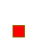

# Bendable Line Sprite Sampling

`BendableLine` keeps neighboring sheet colors out of its sprite region. Its shader clamps samples
to texel centers within that region and selects the finest resident mip. It leaves texture and
importer settings unchanged. The [visual guide](../features/inspector/visual-components.md#bendable-lines)
explains the supported inputs and the mip-residency requirement.

The native regression renders opaque red sprite regions surrounded by green. It checks every
pixel center in the region and checks transparency immediately outside it. It covers one-pixel
and four-pixel regions, point/bilinear/trilinear filters, padding, mipmaps, and texture mip biases
of zero, four, and sixteen. Transparent captures below use the full 64 × 64 render target.

| Input                                  | Before                                                           | After                                                          |
| -------------------------------------- | ---------------------------------------------------------------- | -------------------------------------------------------------- |
| Unpadded, bilinear                     |    |    |
| Padded, bilinear, mipmapped, bias four |  |  |

The original 16-case matrix passed eight cases and failed eight. The final 72 sampling cases pass,
alongside all 35 existing fixture cases, on Unity 6000.6.7f1 with D3D11 in Release PlayMode. There
are no skipped cases. Explicit LOD zero alone was insufficient with positive texture mip bias;
the shader uses a negative requested LOD so the supported sampler bias cannot select a coarser mip.
The point and padded controls remain part of the matrix.

[The evidence record](./bendable-line-sampling-evidence.json) retains the case identities,
source and result digests, process exit observations, image digests, and selected pixel values.
The initial fixture source was not independently sealed; its original results and rendered
examples are retained. This is D3D11 Editor evidence, with no claim about rendering speed or
other graphics backends.

To repeat the capture, run `BendableLineTests` in PlayMode on a graphics-enabled editor. The
repository's native test controller accepts `-EnableEditorGraphics` for D3D11. Set
`UH_SPRITE_CAPTURE_DIRECTORY` to an output directory to retain each PNG. Headless runs explicitly
skip the pixel matrix and continue to test the geometry and lifecycle behavior.
